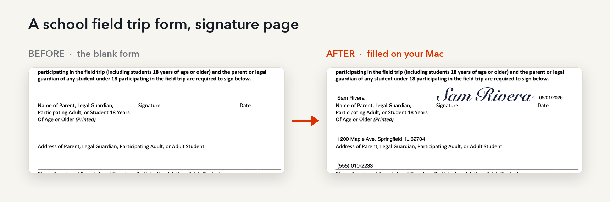
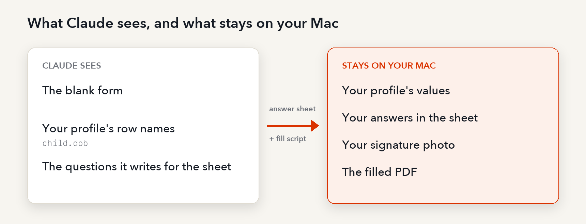
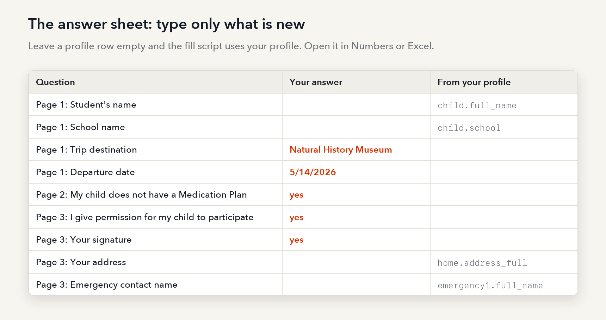
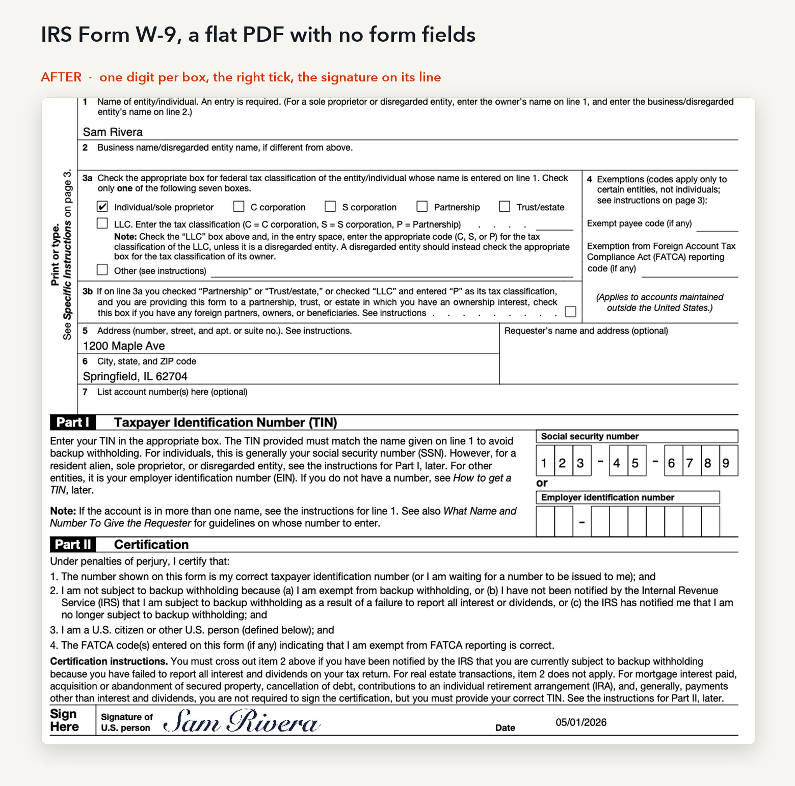

<div align="center">

# pesky-forms

**Fill in those pesky school forms securely from your Mac.**<br>
Claude reads the blank form. Your answers stay on your computer.

[](https://github.com/abe238/pesky-forms/actions/workflows/tests.yml)
[](https://github.com/abe238/pesky-forms/releases)
[](LICENSE)
[](https://docs.claude.com/en/docs/claude-code)
[](#known-risks)



</div>

Field trips, camp, sports physicals. The forms keep coming, and they all ask for the same
facts about your family.

pesky-forms is a Claude Code skill that fills PDF forms for you. Claude reads the blank form
and works out every blank on it. Your answers come from a profile file on your Mac and are
written into the PDF by a small script that runs on your Mac. The workflow never sends your
answers to Claude.

```
/plugin marketplace add abe238/pesky-forms
/plugin install pesky-forms@pesky-forms
```

Then, in Claude Code: *"Help me fill out this form"*, and give it the PDF.

## What you get

- **A filled PDF you can still edit.** Every answer is a real form field, so you fix a typo in
  Preview instead of starting over.
- **One profile for every form.** Type your family's details once. Each new form fills from it,
  and the sheet asks only for what is new (the trip date, the permission checkbox).
- **Flat or fillable PDFs.** Printed forms with no fields, fillable PDFs, checkboxes,
  one-digit-per-box number fields, signature lines and "initial here" boxes.
- **Your signature, if you want it.** Snap a photo of your signature on white paper once;
  the script places it on every signature line as a stamp you can move or delete.
- **Checks before it writes.** Dates, digit counts, lengths and one-choice questions are
  checked first. If something is off, it names the question and writes nothing.

## What Claude sees, and what stays on your Mac



The fill script makes no network connections and prints only which questions were left
empty. The skill tells Claude never to open your profile, your answers or the filled PDF, and
never to run the fill script for you; you run it in your own Terminal app.

Claude Code can read files on your computer, so these are rules Claude follows, backed by a
design that never needs your values. They are not a lock. See [Known risks](#known-risks).

## How it works

1. You give Claude the blank form.
2. Claude finds each blank, checks its placement with sample text, and writes two files:
   `NAME-answers.csv`, a list of questions, and `fill-NAME.py`, the script that fills this form.
3. You open the answer sheet in Numbers or Excel and type only what is new. Rows linked to
   your profile can stay empty.
4. You run the script in Terminal. It checks the answers, fills empty profile rows from your
   profile, and writes `NAME-filled.pdf`. You check it in Preview and sign.



A second child is `--child 2`, which writes `NAME-child2-filled.pdf`. The script will not
replace a filled PDF you have edited or signed in Preview.

### Tax forms too



<sub>All names, numbers and signatures in these images are made up.</sub>

## Install

In Claude Code:

```
/plugin marketplace add abe238/pesky-forms
/plugin install pesky-forms@pesky-forms
```

Or copy `skills/pesky-forms` into `~/.claude/skills/`.

The first time, the skill sets up a small Python environment in `~/.pesky-forms/venv`
(pypdf, pdfplumber, pypdfium2, Pillow). macOS is the tested platform.

## Your first form

1. In Claude Code: "Help me fill out this form" and give it the PDF.
2. First time only: copy `skills/pesky-forms/profile-template.csv` to
   `~/.pesky-forms/profile.csv`, fill in the Value column in Numbers, and export it as CSV
   over the same file. It covers children, parents, home, emergency contacts, doctor and
   insurance. For more children, copy the `child1` rows as `child2`.
3. Open `NAME-answers.csv`, answer what is new, and export it as CSV over the same file.
   Type `blank` in a row to keep it empty even when your profile has a value.
4. In Terminal: `~/.pesky-forms/venv/bin/python fill-NAME.py`
5. Open `NAME-filled.pdf` in Preview, check every answer, sign.

## Tested on real forms

Five public forms with their own fields removed: IRS W-9, IRS W-4 (2026), DC Public Schools
field trip permission, Arlington Public Schools field trip permission, and a hospital
records release. 164 blanks in all, scored by where each answer lands on the page.

| Run | Score |
|---|---|
| Fresh Claude Sonnet agent per form, flat versions, answers typed in the sheet | 164/164 |
| Same kits, profile-linked rows filled from a test profile instead | 164/164 |
| Fresh agent per form, original fillable versions (earlier version of the skill) | 164/164 |
| Script only, answers straight from the key | 164/164 |

Each agent ran once per form. The agents linked 2 to 7 rows per form to profile keys; the
rest were one-off questions such as trip dates and checkboxes.

`tests/test_fill_script.py` checks the fill script's safeguards offline. The harness is in
`bench/`: it downloads the forms (pinned by hash), builds the test
versions, plays a perfect parent and scores the result. It needs PyMuPDF, which only the
bench uses.

## Known risks

You accept these by using it. Read every filled PDF before you sign or send it.

**Privacy**
- Claude reads the form you give it. If the form already has answers, a name or hidden data
  in it, Claude sees those before the skill can stop.
- Claude Code can open any file it is allowed to: your profile, answer sheets, filled PDFs and
  signature images. The skill tells it not to; nothing forces it. Asking Claude to "check my
  filled form" sends your answers to it.
- The names of your profile's rows are visible to Claude. Do not put private facts in a key
  name (`child.diabetes`).
- Files in iCloud-synced folders (Desktop, Documents, Numbers documents, photos) leave your
  Mac for Apple's servers. Keep the forms folder and `~/.pesky-forms/` out of sync if that
  matters to you.
- The fill script's messages name questions and files, never answers. Pasting them into a chat
  still shares those names.

**Wrong or missing answers**
- The answer checks catch wrong digit counts, unreadable dates, answers too long for their box
  and two ticks on one fillable-form question. They cannot tell a right answer from a wrong
  one, and they cannot see "check one" groups on flat forms.
- Spreadsheets can reformat values in ways that still pass the checks (a date read as another
  date). Read the filled PDF.
- Long answers shrink to as small as 6 pt. Characters outside Latin-1 may not display.
- `--force` skips every check.
- `"cover"` boxes hide printed placeholder text (such as "[Enter]" on a draft) under white.
  The hidden text stays in the file, where search or copy can still find it.
- One signature and one set of initials are used for every signer, and a signature placed on a
  crowded line can still touch nearby text.
- Rotated or cropped pages, scans, password-protected PDFs and XFA-only forms are untested
  or unsupported. XFA data is removed from forms that also have regular fields.
- Next year's form is a new file: if its bytes differ, make a new kit.

**Testing scope**
- The scores above come from one run per form, on five digital forms, with synthetic answers
  assigned by position. They show where answers land, not that every question was understood.
- macOS only. Other platforms are untested.

## Related projects

The idea of letting the AI see field names while code fills in the values is an established
pattern; see Simon Willison's "Dual LLM" post (2023) and DeepMind's CaMeL (2025). Projects
in the same space: [pdf-autofillr](https://github.com/Engineersmind/pdf-autofillr),
[pdf-fill-studio](https://github.com/KevinDoremy/pdf-fill-studio),
[ericmjl's pdf-form-filler](https://github.com/ericmjl/skills/tree/main/skills/pdf-form-filler).

## License

MIT
